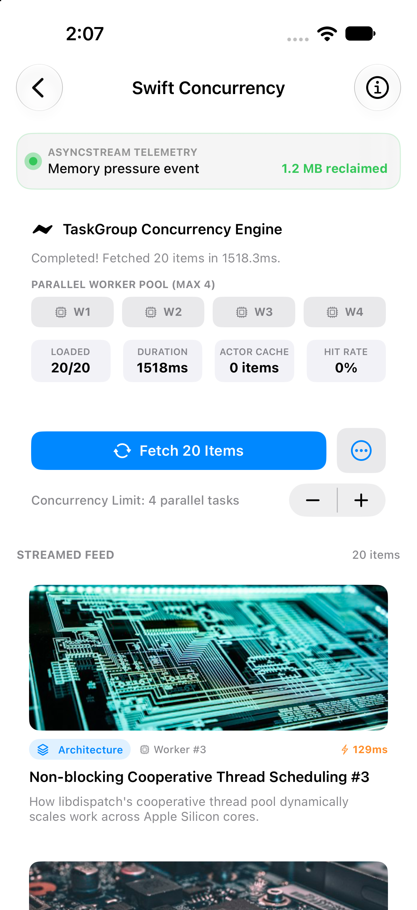

# 01 - Swift Concurrency Demo ⚡️

A production-grade SwiftUI demonstration of modern **Swift 6 Concurrency**, structured task parallelization, compile-time data race elimination, and real-time streaming pipelines.

---

## Screen Preview

  

> 📹 **Screen Recording**: [View recording video (MP4)](recordings/concurrency_demo.mp4)

---

## Highlights & Key Architecture

### 1. Structured Parallel Loading with `TaskGroup`
* Fetches batches of 20 items concurrently using `withThrowingTaskGroup`.
* Employs dynamic concurrency throttling (maximum 4 parallel worker tasks in-flight simultaneously) to avoid socket exhaustion and memory spikes.
* Streams results progressively back to `@MainActor` via `AsyncThrowingStream` so the UI remains fluid without awaiting the whole batch.

### 2. Thread-Safe `ImageCache` Actor
* Memory cache implemented as an `actor` rather than a class with locks (`os_unfair_lock` / `NSLock`).
* **Compile-Time Safety**: Swift 6 compiler statically verifies actor isolation. Data races are impossible.
* **Non-Blocking Cooperative Scheduling**: Execution suspends cooperatively on Swift's thread pool instead of blocking kernel OS threads.
* Implements LRU capacity limits, purge policies, and real-time telemetry (hit/miss counts and hit rate percentage).

### 3. Real-Time Telemetry via `AsyncStream`
* Wraps asynchronous background event generators into an `AsyncStream<LiveUpdate>`.
* Uses `continuation.onTermination` to guarantee zero resource or timer leaks when consumers cancel.
* Consumed seamlessly using `for await update in stream` on `@MainActor`.

### 4. Cooperative Task Cancellation
* Network calls and worker loops check `Task.isCancelled` and invoke `try Task.checkCancellation()`.
* Leaving the demo screen or tapping the Cancel button instantly terminates all in-flight child tasks and streams.

---

## Technical Specifications
* **Language Mode**: Swift 6 (Strict concurrency checking)
* **Minimum Target**: iOS 18.0+
* **Key Frameworks**: SwiftUI, Observation (`@Observable`), Foundation (URLSession Concurrency)
