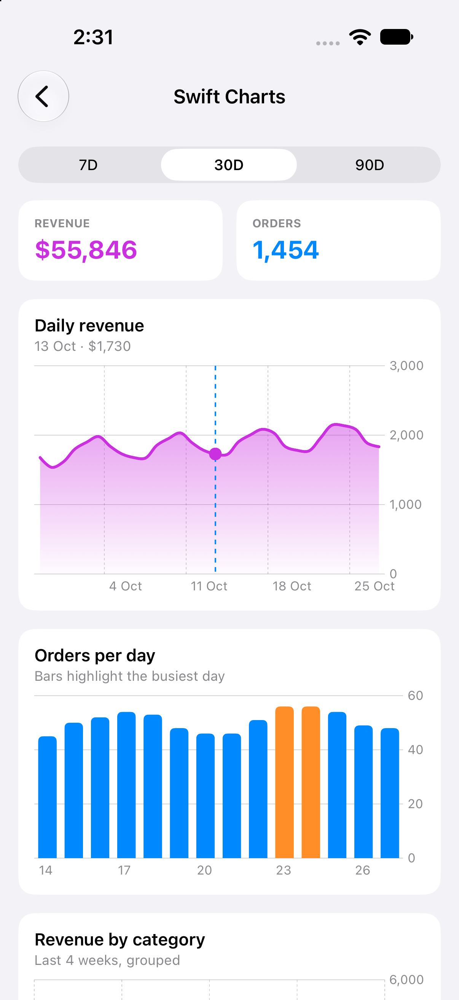
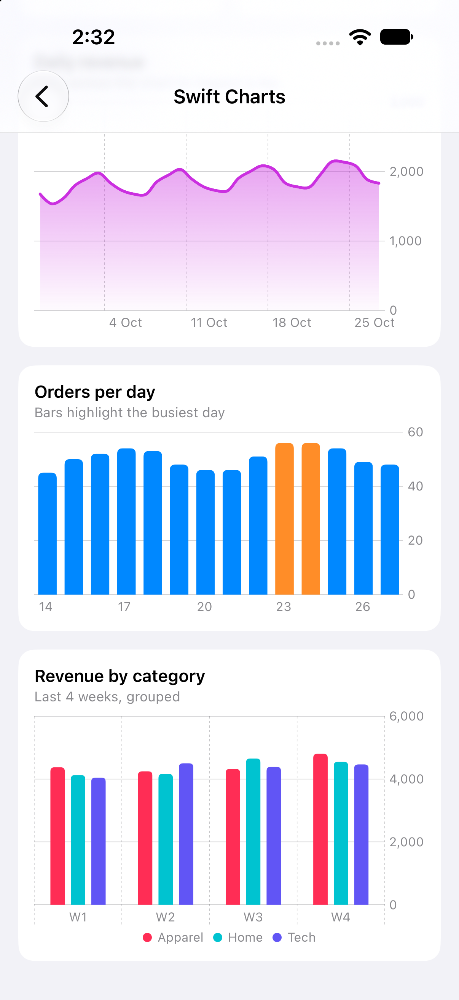
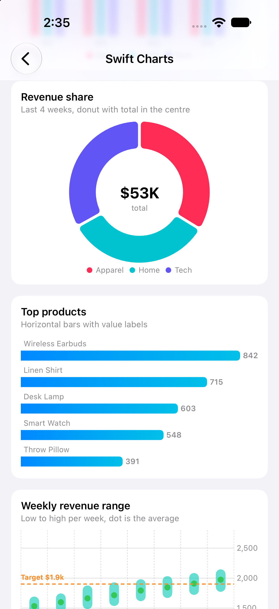
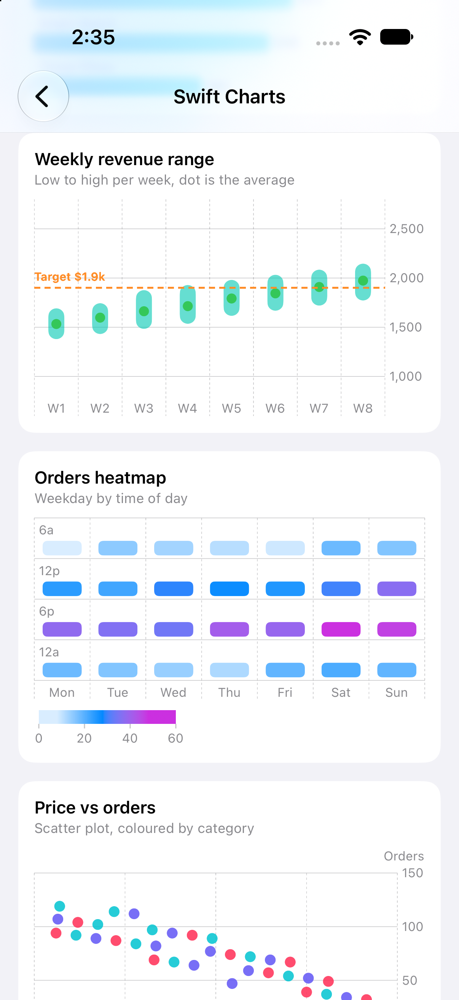
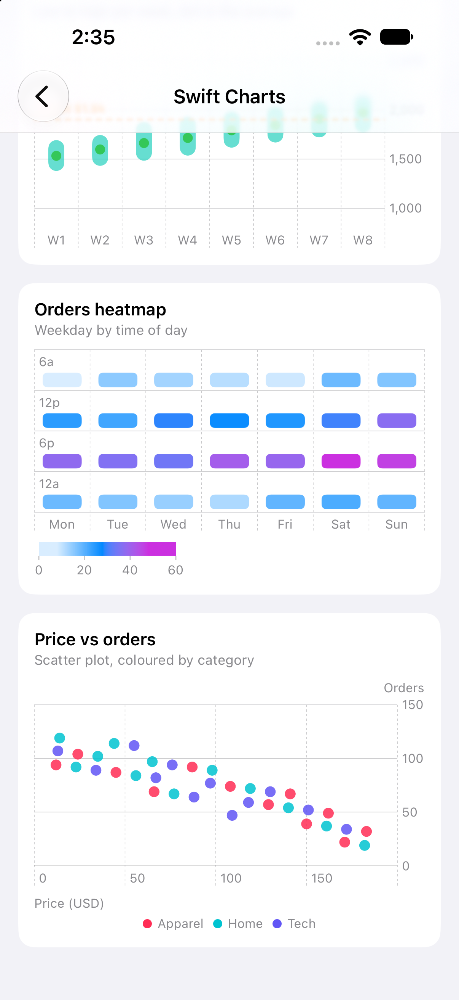
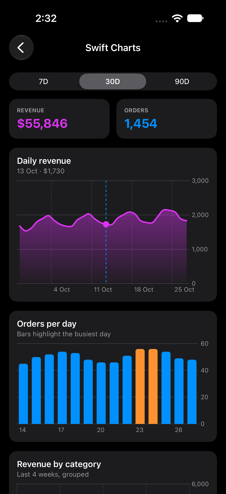

# 02 - Swift Charts Dashboard 📊

An interactive stats dashboard built with **Swift Charts**: 8 chart types (line + area, bar, grouped bar, donut, horizontal ranking, range with target, heatmap, scatter) over a 90-day dataset, with drag selection and a range switcher.

---

## Screen Preview

  
  

  
  

  
  

> 📹 **Screen Recording**: [View recording video (MP4)](recordings/charts_demo.mp4)

---

## Highlights

### 1. Line + Area with Selection
* `LineMark` and `AreaMark` with a gradient fill and `catmullRom` smoothing.
* `chartXSelection` drives a `RuleMark` and `PointMark`; the card subtitle shows the selected day and value.

### 2. Range Switcher (7D / 30D / 90D)
* A segmented control re-slices the data; totals and charts animate together.

### 3. Highlighted Bars
* `BarMark` per day with the peak day coloured differently via a conditional `foregroundStyle`.

### 4. Grouped Bars with Legend
* `position(by:)` groups categories side by side per week; `chartForegroundStyleScale` fixes the colours and `chartLegend` places the legend.

### 5. Donut (`SectorMark`)
* Revenue share with `innerRadius`, `angularInset` and the total drawn in the centre via `chartBackground`.

### 6. Horizontal Ranking
* Top products as horizontal `BarMark`s with a gradient and value `annotation`s.

### 7. Range with Target Line
* `BarMark(yStart:yEnd:)` for weekly low-to-high, `PointMark` for the average, and a dashed `RuleMark` target.

### 8. Heatmap (`RectangleMark`)
* Weekday by time-of-day orders, coloured with `chartForegroundStyleScale(range:)`.

### 9. Scatter Plot
* `PointMark` price vs orders coloured by category, with axis labels.

### 10. Accessibility
* Each chart has an accessibility label and value summary.

---

## Technical Specifications
* **Frameworks**: SwiftUI, Charts
* **Data**: deterministic mock series, so recordings are repeatable
