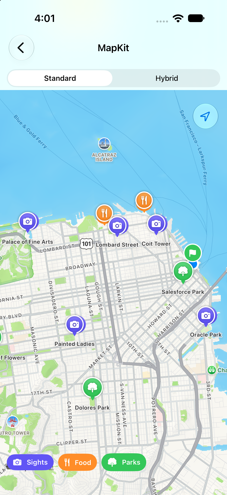
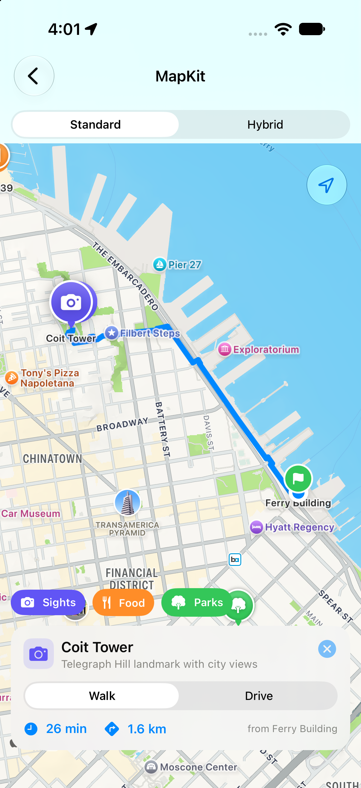
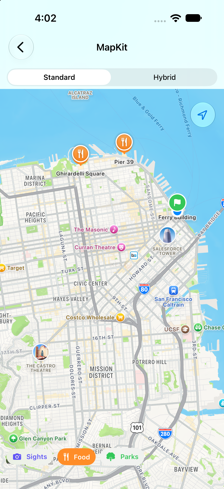
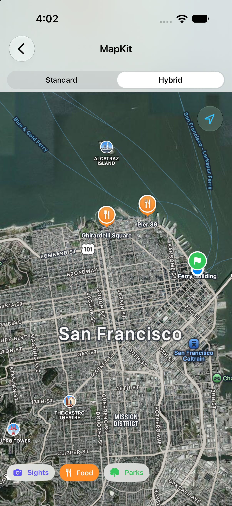

# 03 - MapKit & Directions 🗺️

A SwiftUI map demo with custom annotations, category filtering, and live walking/driving routes drawn as polylines, with distance and ETA.

---

## Screen Preview

  
  
  

  

> 📹 **Screen Recording**: [View recording video (MP4)](recordings/mapkit_demo.mp4)

---

## Highlights

### 1. Custom Annotations
* SwiftUI `Annotation` views: SF Symbol pins coloured by category, with a larger spring-animated state when selected.
* Selection is driven by `Map(selection:)` and a `.tag` on each annotation.

### 2. Live Routes with `MKDirections`
* Every route starts at the Ferry Building and goes to the selected place.
* The result is drawn as a `MapPolyline`; distance and travel time are shown on the detail card.
* Switching between Walk and Drive re-requests the route and cancels any request still in flight.

### 3. Camera Control
* `MapCameraPosition` flies to the selected place with a 3D pitch, then fits the whole route with extra room at the bottom so the card never hides the destination.

### 4. Filters and Map Style
* Category chips filter pins (Sights, Food, Parks).
* Standard and Hybrid styles with realistic elevation; compass, scale view and user location button via `mapControls`.

### 5. Error Handling
* Route failures (no network, no route) show an inline message instead of leaving a stale route on the map.

---

## Technical Specifications
* **Frameworks**: SwiftUI, MapKit, CoreLocation
* **Concurrency**: `@Observable` `@MainActor` view model, `async` route calculation with `Task` cancellation
