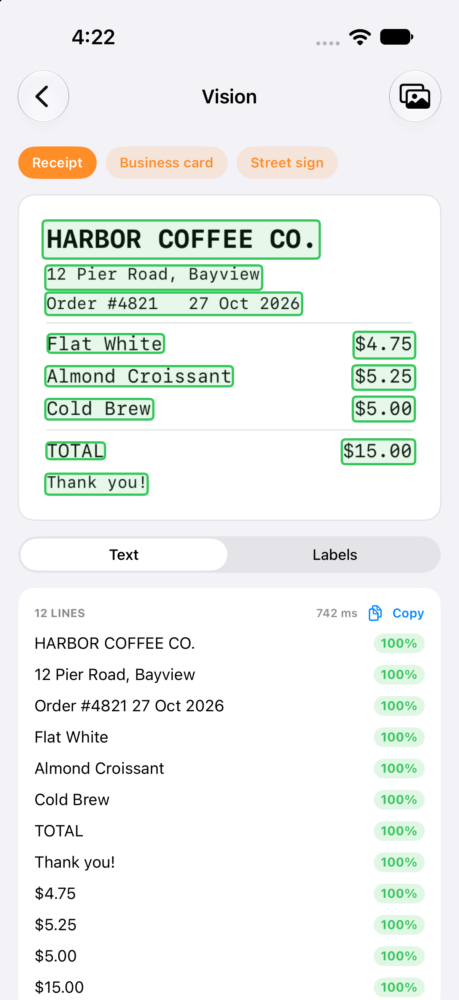
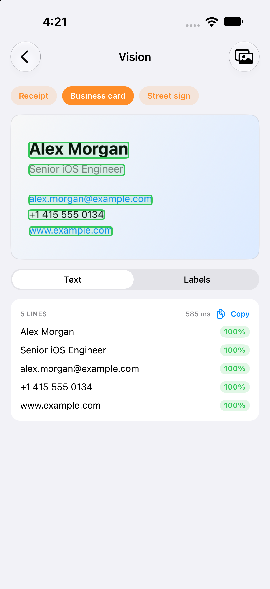
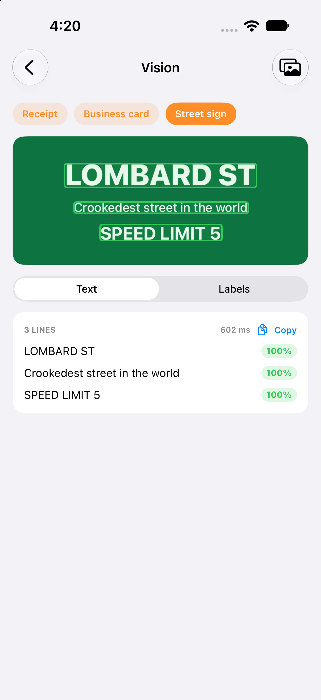

# 04 - Vision: Text Recognition & Image Classification 🔍

On-device text recognition with bounding boxes and confidence, plus image classification, using the Swift Vision API.

---

## Screen Preview

  
  
  

> 📹 **Screen Recording**: [View recording video (MP4)](recordings/vision_demo.mp4)

---

## Highlights

### 1. Text Recognition (`RecognizeTextRequest`)
* Accurate recognition with language correction; every line comes back with a confidence score and a normalized bounding box.
* Boxes are drawn over the image and coloured by confidence (green, orange, red); tap Copy to put all recognised text on the pasteboard.

### 2. Image Classification (`ClassifyImageRequest`)
* Top labels above a confidence threshold, shown with progress bars.
* The built-in classifier is trained on photos, so the drawn sample images give weak guesses. It is meant for pictures chosen with the photo picker; this is not shown in the recording.

### 3. Concurrency
* Both requests run concurrently with `async let`, off the main actor. A failure in one is reported without hiding the other.

### 4. Input
* Three sample images drawn with SwiftUI (receipt, business card, street sign), so the demo works in the Simulator without a photo library.
* `PhotosPicker` for your own pictures. The sample data is fictional.

### 5. Simulator Note
* In the Simulator, classification fails with "Failed to create espresso context" unless the request is pinned to the CPU, so the demo does that in simulator builds only. Real devices use the default compute path.

---

## Not Covered Yet
* Live camera scanning (`DataScannerViewController`) needs a real device and is not built.

---

## Technical Specifications
* **Frameworks**: SwiftUI, Vision, PhotosUI
* **Concurrency**: `async let` for parallel requests, `@MainActor` UI state
