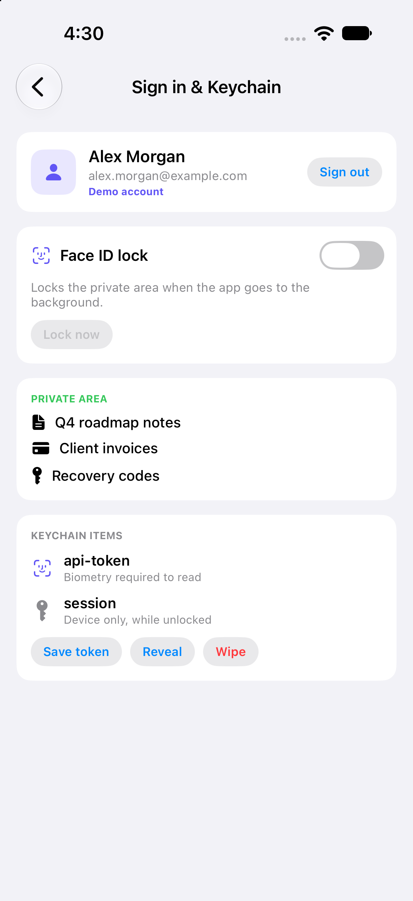
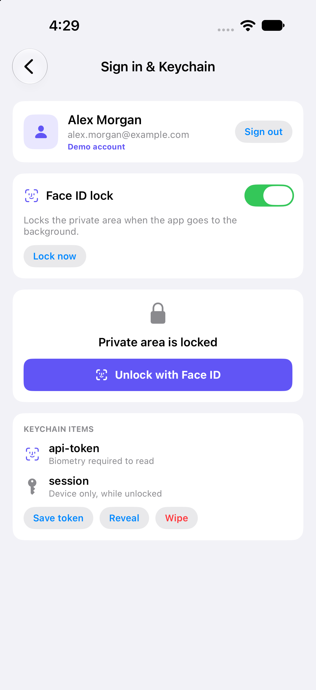
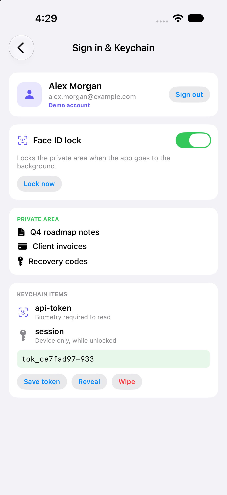

# 05 - Sign in with Apple, Face ID & Keychain 🔐

A sign-in flow with a biometric lock and a Keychain wrapper: sign in, lock the private area behind Face ID, and store a secret that can only be read with Face ID.

---

## Screen Preview

  
  
  

> 📹 **Screen Recording**: [View recording video (MP4)](recordings/auth_demo.mp4)

> ℹ️ **About the recording**: it was captured in the Simulator using the *demo account* and simulated Face ID matches. The Sign in with Apple button is built and wired up, but it has not been run against a real Apple ID yet.

---

## Highlights

### 1. Sign in with Apple
* `SignInWithAppleButton` requesting the name and email scopes.
* Apple returns the name and email only on the first authorization, so the session keeps earlier values when they come back empty.
* `credentialState(forUserID:)` is checked on launch; a revoked or missing credential signs the user out.
* A demo account lets the rest of the flow run where Sign in with Apple is unavailable.

### 2. Face ID Lock
* `LocalAuthentication` with the `deviceOwnerAuthentication` policy, so the device passcode is the fallback and the user is never dead-ended.
* The lock is applied on cold start and when the app goes to the background.
* Errors are mapped to plain messages: not enrolled, not available, lockout, passcode not set, cancelled.

### 3. Keychain Wrapper
* Small `KeychainStore` (save, read, delete, list) over Keychain Services generic passwords.
* Items use `kSecAttrAccessibleWhenUnlockedThisDeviceOnly`: they stay on the device and never sync or back up.
* The API token is saved with a `.biometryCurrentSet` access control; reading it shows the system Face ID prompt, and the read runs off the main thread.
* The session is stored in the Keychain, not in `UserDefaults`.

---

## Setup Notes
* Requires the Sign in with Apple capability (the entitlement file is in the project) and a team with that capability enabled.
* `NSFaceIDUsageDescription` is set in the build settings.
* The Simulator can enrol Face ID from Features > Face ID, or with `notifyutil` for scripted recordings.

---

## Technical Specifications
* **Frameworks**: SwiftUI, AuthenticationServices, LocalAuthentication, Security
* **Concurrency**: `@MainActor` `@Observable` manager, async biometric evaluation, detached Keychain reads
