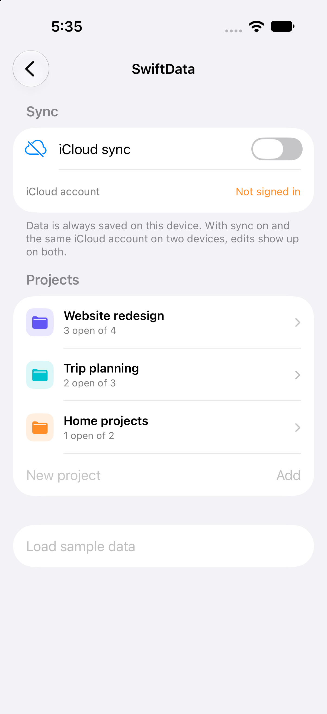
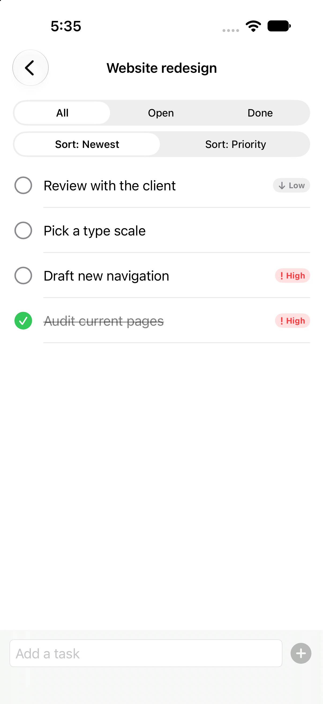
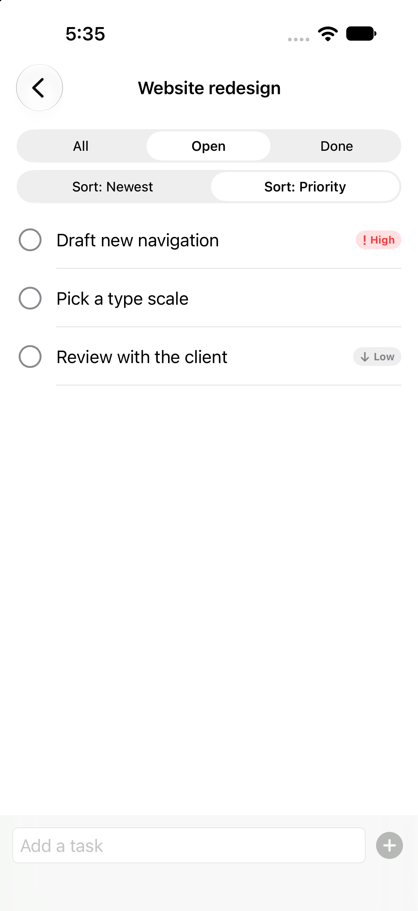
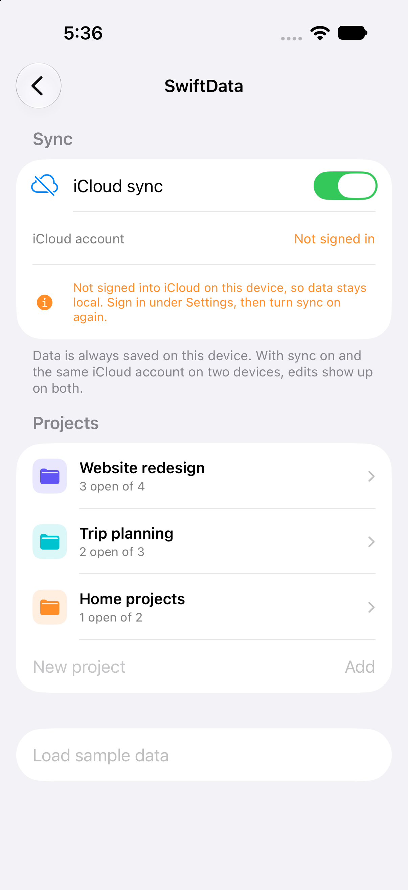

# 06 - SwiftData with CloudKit Sync ☁️

A projects-and-tasks app built on **SwiftData**, with one switch to turn **CloudKit sync** on. Data is always stored on the device first.

---

## Screen Preview

  
  
  
  

> 📹 **Screen Recording**: [View recording video (MP4)](recordings/swiftdata_demo.mp4)

> ℹ️ **What is and isn't shown**: everything above runs on a single Simulator that is **not signed into iCloud**, so no data was synced between devices. The sync switch, the container set-up and the status messages are built; the two-device result (an edit on device A showing up on device B) has **not** been verified yet.

---

## Highlights

### 1. Models that follow the CloudKit rules
* `Project` and `TaskItem` with a one-to-many relationship (`@Relationship`, cascade delete, inverse set).
* Every property has a default value, relationships are optional, and there are no unique constraints, which is what CloudKit requires.
* A stable `uid` on each project is used to look up its tasks. It is an ordinary attribute, not a unique constraint.

### 2. `@Query` with filtering and sorting
* The task list is a child view whose `@Query` is built at init from the chosen filter (All / Open / Done) and sort (Newest / Priority).
* Predicate: `#Predicate<TaskItem> { $0.project?.uid == id && $0.isDone == false }`.

### 3. CloudKit on a switch
* `ModelConfiguration(cloudKitDatabase: .private("iCloud.com.ioslab.demo"))` when sync is on, `.none` when off. The `ModelContainer` is rebuilt when the switch changes.
* Sync is only attempted when the device is signed into iCloud (`ubiquityIdentityToken`); otherwise the app explains why data stays local.
* Sync events (`NSPersistentCloudKitContainer.eventChangedNotification`) are shown as "Setup / Import / Export".
* With CloudKit forced on in the Simulator, the container opened without errors and the CloudKit mirroring set-up ran, so the model rules are accepted.

### 4. Two things learned along the way
* A pushed screen is built in the navigation stack's environment, so it does not see a container attached to the screen that pushed it. The container is attached again on the destination.
* Navigation is keyed on the project's `uid`, not the model object, so saving a change does not pop the screen.

---

## Setup Notes
* iCloud capability with CloudKit and the container `iCloud.com.ioslab.demo` (in the entitlements file). The container must be created for your team in the developer portal.
* `remote-notification` background mode is set so CloudKit can wake the app for changes.
* To try sync: sign into the same iCloud account on two devices (or a device and a signed-in simulator), turn on iCloud sync on both, and edit a task on one.

---

## Not Covered Yet
* Two-device sync (needs the iCloud container registered and two signed-in devices).
* Conflict handling and the offline-then-online case.

---

## Technical Specifications
* **Frameworks**: SwiftUI, SwiftData, CloudKit, CoreData notifications
* **Concurrency**: `@MainActor` `@Observable` storage controller; sync events read from an async notification sequence
