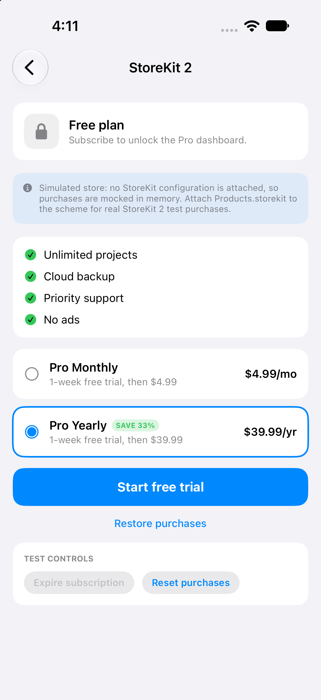
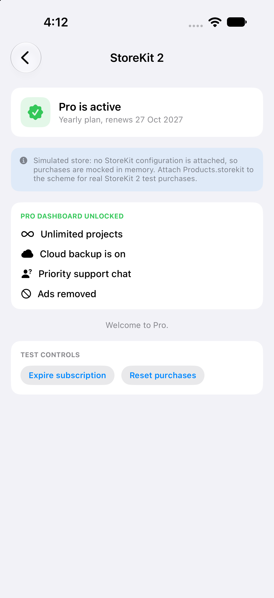

# 07 - StoreKit 2 Subscriptions 💳

A subscription paywall with monthly and yearly plans, a free trial, restore, and Pro-gated content that unlocks and locks again as the subscription changes.

---

## Screen Preview

  
  

> 📹 **Screen Recording**: [View recording video (MP4)](recordings/storekit_demo.mp4)

> ℹ️ **About the recording**: it was captured with the demo's built-in *simulated store*, because the Simulator was launched without a StoreKit configuration attached. The StoreKit 2 code path (`LiveStoreService`) is implemented, but it has not yet been exercised against a local `.storekit` file or a sandbox account.

---

## Highlights

### 1. Store Abstraction
* A small `StoreService` protocol with two implementations: `LiveStoreService` (StoreKit 2) and `SimulatedStoreService` (in memory).
* The UI only sees `StoreItem` values, so the same paywall runs against either store.
* If StoreKit returns no products, the app falls back to the simulated store and says so on screen.

### 2. StoreKit 2 Flow (`LiveStoreService`)
* `Product.products(for:)` to load plans, sorted by price.
* `product.purchase()` with `VerificationResult` handling, then `transaction.finish()`.
* `Transaction.currentEntitlements` decides what is unlocked; `Transaction.updates` keeps it current for renewals and refunds.
* `AppStore.sync()` for restore.

### 3. Paywall UI
* Custom plan picker with a "Save 33%" badge, trial copy, and a Subscribe button with a progress state.
* A second tab shows Apple's `SubscriptionStoreView` when a real store is attached.

### 4. Entitlement Gating
* Free vs Pro status card with the plan and renewal date; the Pro dashboard appears only while entitled.
* Test controls (expire, reset) are available on the simulated store.

### 5. Local Testing File
* `Products.storekit` defines a subscription group with `com.ioslab.pro.monthly` ($4.99) and `com.ioslab.pro.yearly` ($39.99), each with a 1-week free trial.
* To use real StoreKit testing: in Xcode, Edit Scheme > Run > Options > StoreKit Configuration, choose `Products.storekit`.

---

## Technical Specifications
* **Frameworks**: SwiftUI, StoreKit 2
* **Concurrency**: `@MainActor` `@Observable` store manager, `async` purchase and entitlement checks, `AsyncSequence` for transaction updates
