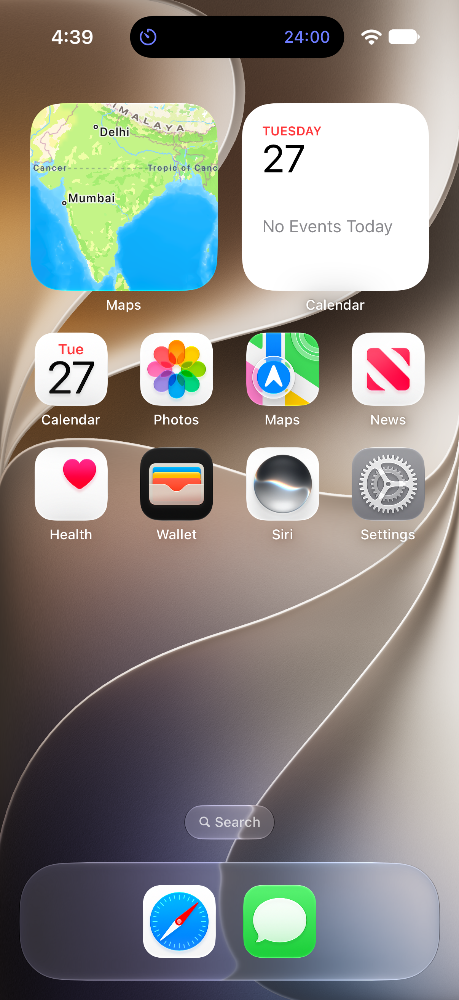
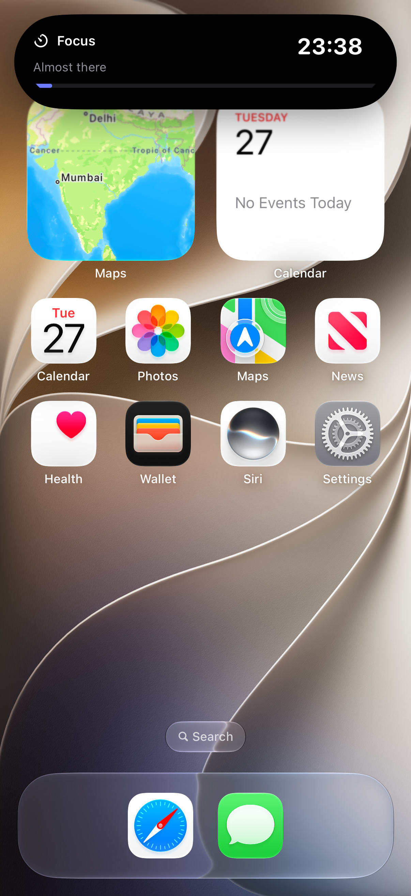
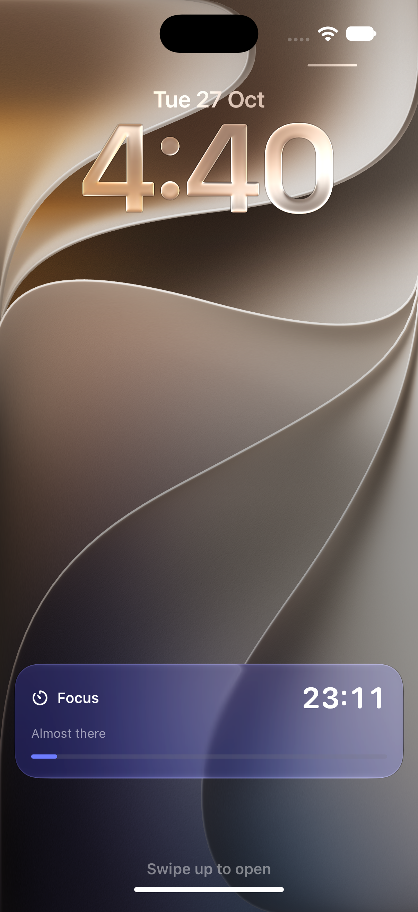
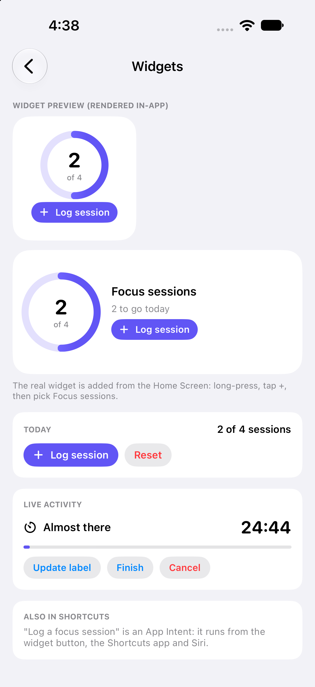
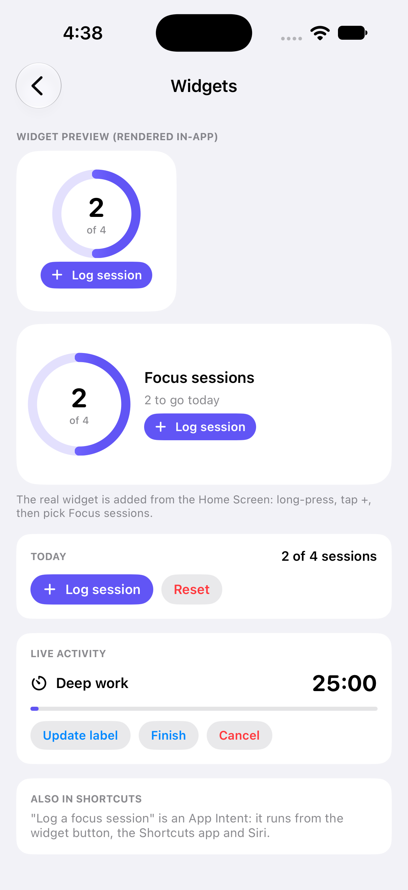

# 08 - Widgets, App Intents & Live Activities ⏱️

A focus-timer demo: a Home Screen widget with an interactive button, an App Intent that also runs from Shortcuts and Siri, and a Live Activity for the Lock Screen and Dynamic Island.

---

## Screen Preview

### Live Activity on the system surfaces

  
  
  

> 📹 **Screen Recording (Lock Screen and Dynamic Island)**: [View recording video (MP4)](recordings/live_activity_lock_screen_and_island.mp4)

### In the app

  
  

> 📹 **Screen Recording (in-app walkthrough)**: [View recording video (MP4)](recordings/widgets_demo.mp4)

> ℹ️ **Still to capture**: the Home Screen widget itself (with its interactive button). The in-app screenshots render the same widget views the extension uses, which is not the same as the widget on the Home Screen.

---

## Highlights

### 1. Widget Extension (`WidgetKit`)
* `StaticConfiguration` widget in small and medium sizes showing a progress ring of today's sessions.
* State is shared with the app through an **App Group** (`UserDefaults(suiteName:)`).

### 2. Interactive Widget + App Intent
* `Button(intent: LogSessionIntent())` logs a session straight from the widget; the intent reloads the widget timeline.
* The same `AppIntent` is exposed to Shortcuts and Siri through an `AppShortcutsProvider`.
* The widget view and intent live in a shared folder compiled into both the app and the extension.

### 3. Live Activity (`ActivityKit`)
* Starts a countdown from the app with `Activity.request`, updates its label, and ends it (finishing logs a session).
* Lock Screen layout with a countdown (`Text(timerInterval:)`) and progress bar; Dynamic Island with compact, minimal and expanded layouts.
* The timer runs on the system side, so it keeps counting while the app is in the background.

---

## Setup Notes
* Widget extension target `iOSLabWidgets`, embedded in the app.
* App Group `group.com.ioslab.demo` on both targets (must be enabled for your team in the developer portal for device builds).
* `NSSupportsLiveActivities` is set on the app.

---

## Not Covered Yet
* The real Home Screen widget and its button.
* Running on a real device, and updating the Live Activity from a push notification.

---

## Technical Specifications
* **Frameworks**: SwiftUI, WidgetKit, ActivityKit, AppIntents
* **Concurrency**: `@MainActor` `@Observable` view model; `Activity` is not `Sendable`, so only its id is kept and it is looked up in `nonisolated` helpers
