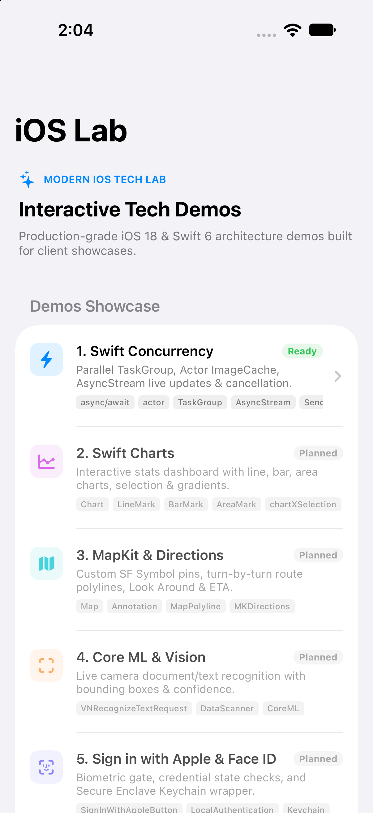

# iOS Lab Showcase 🚀

A showcase repository featuring modern iOS tech demos, screen recordings, interactive screenshots, and architectural highlights.

  

## Tech Demos Overview

| # | Demo Module | Highlights & Key APIs | Media Preview | Status |
|---|-------------|-----------------------|---------------|--------|
| 1 | **Swift Concurrency** | `async/await`, `actor`, `@MainActor`, `Sendable`, `TaskGroup`, `AsyncStream` | [Media & Details](01-Swift-Concurrency/) | ✅ Completed |
| 2 | **Swift Charts** | Line, Bar, Area charts, Selection, Gradients, Dark Mode | [Media & Details](02-Swift-Charts/) | ⏳ Planned |
| 3 | **MapKit** | Custom Annotations, Directions & Route Polylines, User Tracking | [Media & Details](03-MapKit/) | ⏳ Planned |
| 4 | **Core ML & Vision** | Real-time text/image recognition, Camera scanner | [Media & Details](04-Vision-CoreML/) | ⏳ Planned |
| 5 | **Biometrics & Keychain** | Sign in with Apple, Face ID / Touch ID, Secure Enclave Keychain | [Media & Details](05-Auth-Keychain/) | ⏳ Planned |
| 6 | **SwiftData + CloudKit** | Multi-device background sync, `@Model`, `@Query`, Relationships | [Media & Details](06-SwiftData-CloudKit/) | ⏳ Planned |
| 7 | **StoreKit 2** | Subscriptions, Paywalls, Trial, Transaction verification | [Media & Details](07-StoreKit2/) | ⏳ Planned |
| 8 | **Widgets & Live Activities** | Home Screen Widgets, Dynamic Island, App Intents | [Media & Details](08-Widgets-LiveActivities/) | ⏳ Planned |

---

> [!NOTE]
> Source code for this lab is maintained in a private repository. This repository acts as a public showcase for client demos, visual updates, screen recordings, and documentation.
